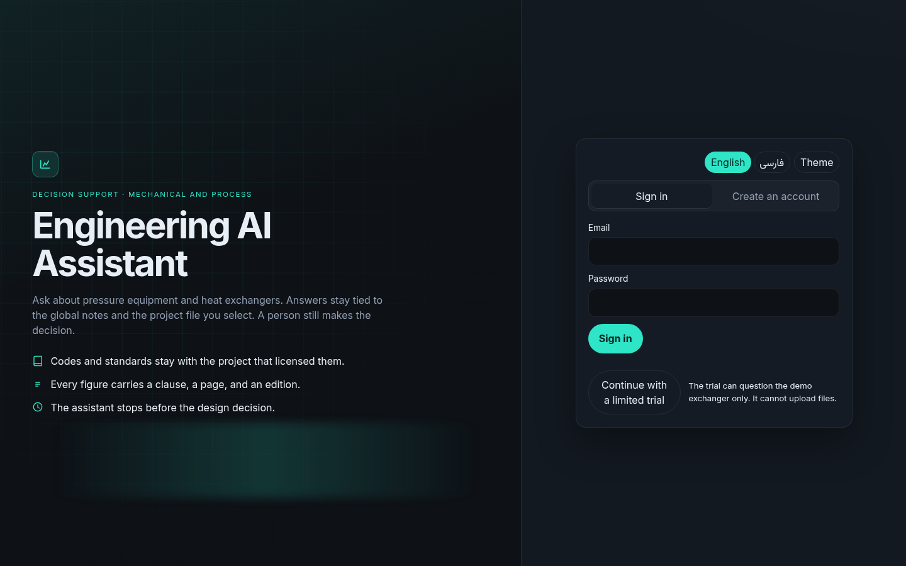
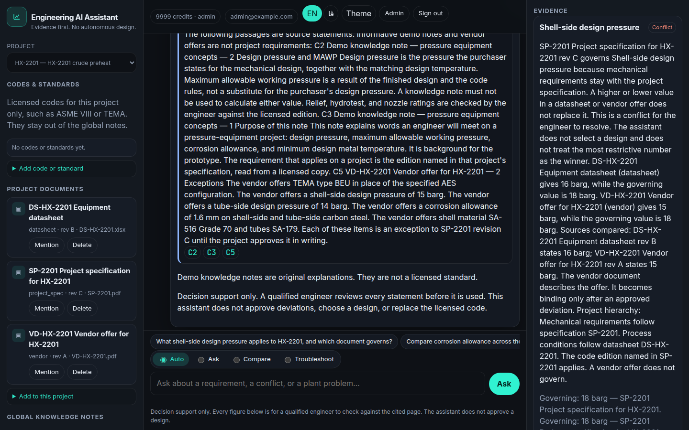
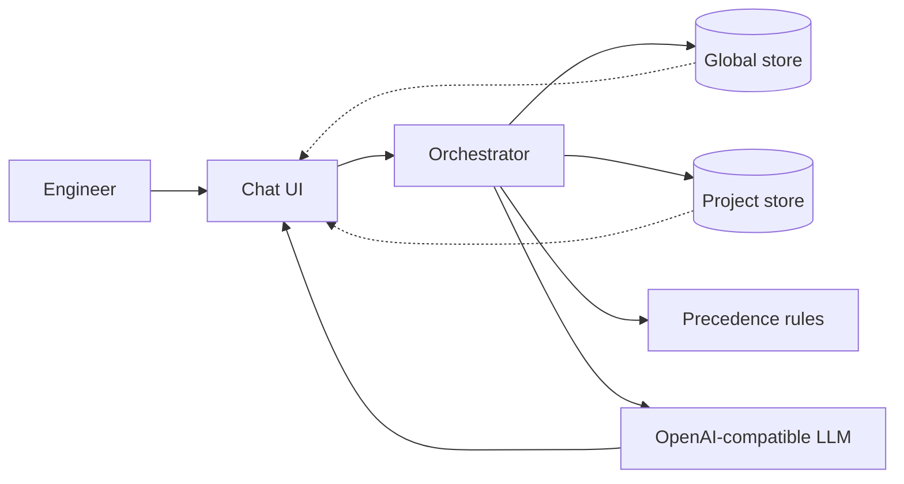

# Engineering AI Assistant

Decision-support chat for mechanical and process engineers working on pressure equipment and heat exchangers. An engineer asks in plain language. The assistant answers from two separate knowledge stores and shows the page it used. It does not approve a design, accept a deviation, or replace the licensed code.

**[Live demo](https://engineering-ai-assistant-i9fb.onrender.com).** The free host sleeps when idle, so the first load may take about 30–60 seconds.





The shipped corpus is original demo text. It is not ASME, API, TEMA, ASTM, ISO, or EN, and it is not for design.

## What you can do

- Ask a general question against the global knowledge notes.
- Open a project, upload PDF or Excel, and ask against that project plus the global notes.
- Keep licensed codes for that project under **Codes & Standards** (کدها و استانداردها), separate from **Project documents** (مدارک پروژه). Citations show the edition.
- Type `@` in the composer, or use **Mention**, to limit an answer to selected files.
- Read every answer as labeled blocks: explicit requirement, engineering recommendation, or AI interpretation, each with citations (document, clause, page, revision or edition, excerpt).
- Compare a specification, a datasheet, and a vendor offer. Conflicts follow the project document hierarchy. A higher or lower number does not win by being more restrictive.
- Describe a plant problem and get considerations, limits, and the project constraints that bound them.
- Sign in, spend monthly credits, and, as an administrator, issue access codes and top up balances.

Vendor document review as a separate workflow is out of scope for this prototype.

Questions can be asked in Persian, or in a mix of Persian and Latin terms such as ASME, TEMA, and barg. The answer is written in the language of the question. Document titles, clause numbers, revisions, units, and numeric values stay as they appear in the source. Requirement, recommendation, and interpretation labels switch with the interface language. The chat UI has an English / فارسی control and lays out right to left when Persian is selected. The project page has the same split: `docs/index.html` and `docs/fa/index.html`.

Retrieval still runs on the English corpus. A Persian question is expanded with a fixed engineering glossary and, when `QUERY_TRANSLATION=both` and a model key is set, with an English rewrite from the model. That rewrite is what makes Persian search work on the free Render host, which does not load a multilingual embedding model. Uploaded Persian text is normalized before indexing: Arabic yeh and kaf fold to the Persian letters, ZWNJ becomes a space, and Persian or Arabic digits become Western digits.

## Run it locally

Python 3.12.

```bash
python -m venv .venv
source .venv/bin/activate
pip install -r requirements-dev.txt
cp .env.example .env
# Put a Groq key in GROQ_API_KEY if you want prose from a model.
# With no key, answers are extractive quotations and still cited.
uvicorn app.main:app --host 0.0.0.0 --port 7860
```

Open http://localhost:7860.

The demo project **HX-2201 crude preheat** and the private project **HX-900** are ingested on startup. Sign in with `ADMIN_EMAIL` / `ADMIN_PASSWORD` from `.env`, or use **Continue with a limited trial** (demo project only, a handful of questions, no uploads).

### Docker

```bash
cp .env.example .env
# optional: edit GROQ_API_KEY and ADMIN_PASSWORD
docker compose up --build
```

Compose turns `DEMO_MODE` off so local registration and uploads work. The image itself defaults `DEMO_MODE=true` for a public host. The service listens on port **7860**.

## Environment variables

Copy `.env.example`. Nothing secret is hardcoded.

| Variable | Role |
| --- | --- |
| `LLM_PRESET` | `groq` (default), `gemini`, `openai`, `ollama`, or `custom` |
| `GROQ_API_KEY` | Free Groq key. Default preset reads this. |
| `GEMINI_API_KEY` | Used when `LLM_PRESET=gemini` |
| `OPENAI_API_KEY` | Used when `LLM_PRESET=openai` |
| `LLM_BASE_URL`, `LLM_MODEL`, `LLM_API_KEY` | Override the preset. Any OpenAI-compatible server works (OpenAI, Azure, Groq, Gemini, Ollama). |
| `LLM_PROVIDER` | `auto` calls the API when a key exists, otherwise quoted excerpts. `none` never calls a model. |
| `EMBEDDING_PROVIDER` | `fastembed` (CPU ONNX, loaded on first embed) or `hash` (no model). The [Render](#deploy-on-render) free service uses `hash`. |
| `EMBEDDING_MODEL` | Used only when the provider is `fastembed`. Default is `sentence-transformers/paraphrase-multilingual-MiniLM-L12-v2` (about 0.22 GB). `intfloat/multilingual-e5-small` is not in the installed fastembed build. |
| `QUERY_TRANSLATION` | `both` (default), `glossary`, `llm`, or `off`. Persian questions use this path to search the English corpus. |
| `DATABASE_URL` | Empty means SQLite in `DATA_DIR`. Postgres URL is rewritten to `postgresql+psycopg://`. |
| `ADMIN_EMAIL`, `ADMIN_PASSWORD` | Bootstrap administrator. The password is stored as a bcrypt hash. Restart does not overwrite an existing admin. |
| `DEMO_MODE` | `true` closes open registration and rate-limits uploads and chat. |
| `DEMO_ALLOW_REGISTRATION` | When demo mode is on, `true` allows signup without a code. |
| `TRIAL_CREDITS` | Questions in an anonymous trial. Default 5. |
| `CREDIT_COST_PER_QUERY` | Credits spent per chat. Default 1. |
| `FREE_MONTHLY_CREDITS`, `PRO_MONTHLY_CREDITS` | Plan allowances. Default 40 and 400. |
| `STRIPE_SECRET_KEY`, `STRIPE_WEBHOOK_SECRET`, `STRIPE_PRICE_PRO` | All three must be set or checkout stays off. |
| `OCR_ENABLED` | `true` plus the `tesseract` binary OCRs sparse PDF pages and images. |
| `SECRET_KEY` | Session signing material. Change it before any public host. |

### Groq and Gemini presets

Groq, the default:

```bash
LLM_PRESET=groq
GROQ_API_KEY=gsk_...
# LLM_BASE_URL=https://api.groq.com/openai/v1
# LLM_MODEL=openai/gpt-oss-120b
```

Groq retired `llama-3.3-70b-versatile` on 16 August 2026. The preset now calls `openai/gpt-oss-120b` at `https://api.groq.com/openai/v1/chat/completions`. An administrator can confirm the live call with `GET /api/admin/llm-check`.

Gemini’s OpenAI-compatible endpoint:

```bash
LLM_PRESET=gemini
GEMINI_API_KEY=...
# LLM_BASE_URL=https://generativelanguage.googleapis.com/v1beta/openai/
# LLM_MODEL=gemini-2.5-flash
```

Keys belong in the environment or in Hugging Face Space secrets. Do not commit them.

## Architecture

Hybrid retrieval with a small reasoning step. The global knowledge base and each project live in different Chroma directories and are queried separately. Their hits are combined only while answering.



Lexical search (SQLite FTS5, or token overlap on Postgres) and vector search run inside each store. Reciprocal rank fusion merges the lists. The precedence step reads structured claims extracted at ingest. The language model, when a key is configured, may only write from that evidence pack. If it is absent or fails, the answer quotes the excerpts directly.

Accounts, credits, documents, and claims live in SQLite by default. Set `DATABASE_URL` to Postgres when you need a shared database. Chroma stays on local disk either way.

Project membership is checked before a project store is opened. A public demo project is readable by any signed-in user, including the trial. Private projects are visible only to members and administrators. Selecting project A never searches project B’s directory.

## Ingest documents

Use the upload form on a project, or `POST /api/projects/{id}/documents` as multipart form data (`file`, `doc_type`, `revision`, `edition`). PDF text and tables, and Excel rows, are extracted. Each chunk keeps the file name, page (or `Sheet!row`), clause or row label, revision, edition, and statement class.

Global uploads are limited to an administrator (`POST /api/kb/documents`).

### Load your own licensed standards

1. Sign in as the administrator.
2. Upload the PDF you are licensed to use, with the real edition in the edition field and a revision if you have one.
3. Treat it as a `standard_note` unless your counsel says the file may be stored for this use.
4. The demo notes stay in the index until you delete them. They are labeled `DEMO CORPUS` and must not be cited as the code.
5. On a project specification, name the edition that applies. The assistant treats that statement as the project requirement. A different edition in the global store does not replace it.

Scanned pages need `OCR_ENABLED=true` and Tesseract. The Docker image includes Tesseract. OCR is off unless you turn it on.

## Precedence and conflicts

HX-2201 states its own order. The assistant applies that order. It does not pick the most restrictive value.

1. Site law, when a document says so.
2. Project specification, latest revision: mechanical design, materials, code editions, corrosion allowance, TEMA type.
3. Datasheet, latest revision: process conditions only. A lower design pressure or corrosion allowance on the datasheet does not relax the specification. It is a conflict.
4. The code edition named in the specification. Explanatory notes are not an edition.
5. Vendor documents describe the offer. A difference is a deviation until the project approves it. A vendor value of 14 barg does not replace a specified 12 barg, and a vendor value of 15 barg does not replace a specified 18 barg.

The demo conflicts:

| Topic | Specification Rev C | Datasheet Rev B | Vendor offer Rev A | What governs |
| --- | --- | --- | --- | --- |
| Shell design pressure | 18 barg | 16 barg | 15 barg | Specification, 18 barg |
| Tube design pressure | 12 barg | 12 barg | 14 barg | Specification, 12 barg |
| Tube corrosion allowance | 3.0 mm | 1.5 mm | 1.6 mm | Specification, 3.0 mm |
| TEMA type | AES | AES | BEU | Specification, AES |

## Accounts, credits, codes

Passwords are hashed with bcrypt. Each chat query spends `CREDIT_COST_PER_QUERY` credits. The balance returns to the plan allowance when `period_end` passes. Unused credits do not roll over. A code adds credits to the current period and can assign Free or Pro. The next monthly reset uses the plan allowance only.

The administrator UI (the Admin button) lists users, generates and revokes codes, tops up or resets credits, and changes plans. Bootstrap the first admin with `ADMIN_EMAIL` and `ADMIN_PASSWORD`.

Anonymous trial sessions exist when `DEMO_TRIAL_ENABLED` is true. They cannot upload or redeem a code.

### Stripe

Checkout is disabled until `STRIPE_SECRET_KEY`, `STRIPE_WEBHOOK_SECRET`, and `STRIPE_PRICE_PRO` are all set.

1. In Stripe test mode, create a recurring price for the Pro plan.
2. Point a webhook at `https://YOUR_HOST/api/billing/webhook`.
3. Subscribe the endpoint to `checkout.session.completed`, `invoice.paid`, and `customer.subscription.deleted`.
4. Set the three variables and restart.

`checkout.session.completed` and `invoice.paid` set the plan to Pro and refill the monthly allowance. `customer.subscription.deleted` returns the account to Free. The balance is left in place until the current period ends, then the Free allowance applies.

## Tests and the RQ4 check

```bash
pytest
EMBEDDING_PROVIDER=hash LLM_PROVIDER=none python eval/rq4_traceability.py
```

`pytest` covers PDF and Excel ingestion, project store isolation, citation fields, precedence (including a higher vendor value that must not govern), credit deduction, monthly reset, code redemption, and a query blocked at zero credits.

`eval/rq4_traceability.py` asks the demo project a fixed set of questions and checks that the citation is the governing document, clause, page, and revision. It exits non-zero if a case misses.

## Deploy the public demo

The live demo is [https://engineering-ai-assistant-i9fb.onrender.com](https://engineering-ai-assistant-i9fb.onrender.com), a free [Render](https://render.com) web service built from this repo’s Dockerfile. The free host sleeps when idle, so the first load may take about 30–60 seconds. GitHub Pages is the project page. A Hugging Face Docker Space is optional and paid on this account.

### 1. GitHub

Push this repository to GitHub. The public remote is `https://github.com/hamid-ahmadiasl/engineering-ai-assistant`.

### 2. Project page (GitHub Pages)

The page is `docs/index.html` (Persian: `docs/fa/index.html`).

Either:

- Settings → Pages → Build and deployment → Source: **Deploy from a branch** → branch `main` → folder `/docs`, or
- Settings → Pages → Source: **GitHub Actions**. The workflow `.github/workflows/pages.yml` publishes `docs/` on pushes that touch that folder.

The project page buttons open the [live demo](https://engineering-ai-assistant-i9fb.onrender.com).

### Deploy on Render

[](https://render.com/deploy?repo=https://github.com/hamid-ahmadiasl/engineering-ai-assistant)

`render.yaml` is a Blueprint for one web service: Docker runtime, free plan, this Dockerfile, health check `/api/health`.

1. Click **Deploy to Render** (or in the Render dashboard: New → Blueprint, and select this repository).
2. Render reads `render.yaml` from `main`.
3. When it asks for values, enter the four below. `SECRET_KEY` is generated for you. The other keys in the Blueprint already have values; leave them.
4. Apply the Blueprint and wait for the Docker build. The live service is [https://engineering-ai-assistant-i9fb.onrender.com](https://engineering-ai-assistant-i9fb.onrender.com).
5. Open `/api/health`. `embedding` should be `hash`, and `demo_mode` should be true.

The process binds `0.0.0.0:$PORT`. Render sets `PORT`. When `PORT` is unset (local Docker, Hugging Face), the image listens on **7860**, so those hosts are unchanged.

**Free disk is ephemeral, and the service sleeps after about 15 minutes without a request.** A wake, a restart, or a new deploy starts a fresh container. SQLite, Chroma, and uploaded files on the instance disk are gone. The demo corpus is ingested again on boot. For accounts and credits that survive sleep, set `DATABASE_URL` to a free [Neon](https://neon.tech) Postgres URL (`postgresql://…?sslmode=require`). The vector index still lives on the instance disk and is rebuilt when the seed runs. Treat uploads on the free instance as temporary.

#### Values you type in

| Variable | What to enter |
| --- | --- |
| `GROQ_API_KEY` | Groq API key. Without it the demo still answers, using quoted excerpts, and Persian search uses only the glossary. |
| `ADMIN_EMAIL` | Bootstrap administrator email. |
| `ADMIN_PASSWORD` | Bootstrap administrator password. Stored as a bcrypt hash. |
| `DATABASE_URL` | Optional. Leave blank for ephemeral SQLite. A Neon URL keeps users and credits across sleep and deploys. |

`SECRET_KEY` is created by Render (`generateValue`). Do not paste a secret into the repo.

#### Memory

The free instance has **512 MB RAM** and **0.1 CPU**. `intfloat/multilingual-e5-small` is not in the installed fastembed release. The multilingual ONNX models that are (`sentence-transformers/paraphrase-multilingual-MiniLM-L12-v2` at about 0.22 GB on disk, `intfloat/multilingual-e5-large` at about 2.24 GB) plus ONNX Runtime and Chroma do not fit that limit, and baking a model into the image would also blow the build. The Blueprint sets `EMBEDDING_PROVIDER=hash`: a deterministic token hash, no download, loaded on the same path the tests use. Import plus demo ingestion stayed under 200 MB RSS locally.

Persian retrieval still works. `QUERY_TRANSLATION=both` expands a Persian question with the engineering glossary and, when `GROQ_API_KEY` is set, an English rewrite. Lexical search runs on that English text. On a larger instance, set `EMBEDDING_PROVIDER=fastembed` to load `EMBEDDING_MODEL` on first embed instead of at image build.

### 3. Hugging Face Space (optional, paid)

Docker Spaces are paid on this account. Use them only if you want a second host. The free demo is Render.

1. Create a Space, SDK **Docker**, hardware **CPU Basic** (or larger if you set `EMBEDDING_PROVIDER=fastembed`).
2. Note the id, for example `hamid-ahmadiasl/engineering-ai-assistant`.
3. In the GitHub repository secrets, set `HF_TOKEN` (a Hugging Face write token) and `HF_SPACE` (the `user/space` id).
4. Push to `main`. `.github/workflows/huggingface-space.yml` copies the repo to the Space and prepends the Docker front matter (`sdk: docker`, `app_port: 7860`). The workflow skips itself when the secrets are missing.
5. In the Space settings, add secrets, not files:

   - `GROQ_API_KEY`
   - `SECRET_KEY`
   - `ADMIN_EMAIL`
   - `ADMIN_PASSWORD`
   - `DATABASE_URL` if you want accounts to survive a restart
   - leave `DEMO_MODE` at the image default `true`

The container listens on `$PORT` or 7860. On startup it ingests the demo corpus. With the image default `EMBEDDING_PROVIDER=fastembed`, the multilingual model downloads on first embed into `FASTEMBED_CACHE_PATH`.

**Space disk is ephemeral.** A restart wipes SQLite, uploads, and the vector indexes. The demo corpus is rebuilt on boot. For real accounts and credits, put `DATABASE_URL` on a free hosted Postgres such as [Neon](https://neon.tech) or [Supabase](https://supabase.com).

### Demo guard

With `DEMO_MODE=true`:

- Registration requires an access code unless `DEMO_ALLOW_REGISTRATION=true`.
- The anonymous trial is a few questions on HX-2201 and cannot upload.
- Chat is rate-limited per account, and uploads are capped per plan per day.

## Google Drive storage

Uploads go to **each user's own** Google Drive, not a shared bucket. Account data, document rows, and chunk text (page, clause, revision, edition) stay in Postgres (`DATABASE_URL`). The vector index is rebuilt from those chunks in the background when the Render disk is empty, so a restart does not require uploading again. Deleting a file in the app deletes the Drive file, the database rows, and the vectors. If someone deletes the file in Drive itself, the indexed text stays and the row is marked source file missing.

Until you add yourself as a test user and connect Drive, uploads are refused. Set `ALLOW_LOCAL_UPLOADS=true` only for a local machine; those copies are marked temporary and disappear when the disk does.

### Google Cloud Console

1. Open [Google Cloud Console](https://console.cloud.google.com/) and create a project.
2. APIs & Services → Library → enable **Google Drive API**.
3. APIs & Services → OAuth consent screen → **External** → Testing. Add the Google accounts that will use the demo (the owner included). Testing mode allows about **100 test users** until the app is verified.
4. APIs & Services → Credentials → Create credentials → **OAuth client ID** → Application type **Web application**.
5. Authorized redirect URI, exactly:

   `https://engineering-ai-assistant-i9fb.onrender.com/api/drive/callback`

6. Copy the client id and secret into `GOOGLE_CLIENT_ID` and `GOOGLE_CLIENT_SECRET`.
7. Set `PUBLIC_BASE_URL` to `https://engineering-ai-assistant-i9fb.onrender.com` (no trailing path).
8. In the app, each person uses **Connect Google Drive**. The request uses scope `https://www.googleapis.com/auth/drive.file` only, `access_type=offline`, and `prompt=consent`. The refresh token is encrypted with `TOKEN_ENC_KEY` or, if that is empty, `SECRET_KEY`. **Disconnect** revokes it and deletes the stored token.

Files are created in that user's Drive under a root folder `EAIA`:

- `EAIA/General Codes and STD` holds the user's own general codes and standards.
- `EAIA/<project number> - <project name>/` is created with **+ New project**. The dialog asks which of Owner, Consultant, Vendor, and Third Party to create, and accepts extra folder names. Folders nest at least three levels (for example Vendor / Pump vendor / Datasheets).
- The app tree and the Drive folders stay in step. Uploading into a folder writes the file there. Moving a file between folders calls Drive `addParents` / `removeParents`. Renaming or deleting a folder does the same to the Drive folder.

Signed-in answers search only documents that user uploaded. The shipped demo notes stay on the anonymous trial and are not mixed into a signed-in answer. Precedence defaults to Owner, then Consultant, then Third Party, then Vendor, with General Codes and STD as the baseline. Each project can reorder that list in its settings. Citations show the folder role.

### Supabase for the database

1. Create a project at [Supabase](https://supabase.com/).
2. Project Settings → Database → **Connection string** → **Session pooler** (port 5432, not the 6543 transaction pooler).
3. Paste it into Render as `DATABASE_URL`, and add `?sslmode=require` if it is not already there.
4. A Neon Postgres URL with `sslmode=require` works the same way.

The owner sets these on the Render service (Blueprint keys are `sync: false`):

| Variable | Value |
| --- | --- |
| `DATABASE_URL` | Supabase Session pooler URI, `sslmode=require` |
| `GOOGLE_CLIENT_ID` | OAuth web client id |
| `GOOGLE_CLIENT_SECRET` | OAuth web client secret |
| `PUBLIC_BASE_URL` | `https://engineering-ai-assistant-i9fb.onrender.com` |
| `TOKEN_ENC_KEY` | Optional long random string. Empty uses `SECRET_KEY`. |
| `ADMIN_EMAIL` | Bootstrap admin email |
| `ADMIN_PASSWORD` | Bootstrap admin password. Changing it updates the stored hash on the next boot. |
| `GROQ_API_KEY` | Groq key, if model prose is wanted |

## Limitations

- Demo notes are original teaching text. They are not a code or a calculation.
- The assistant does not size a vessel, check a formula, or accept a vendor exception.
- A language model can still misread an excerpt. The citation panel is the check. Extractive mode quotes the excerpt instead of paraphrasing it.
- OCR is optional and weak on drawings. P&IDs are not interpreted as graphics.
- Precedence uses claims captured at ingest (the demo sidecars, and section labels on uploads). A PDF with no clear parameter names will not produce a conflict card by itself.
- Credits and sessions are prototype controls, not a billing platform. Stripe is optional and off by default.
- One process, one Chroma directory tree. Run a single replica or give each replica its own disk.

## Layout

```
app/            FastAPI service, ingestion, retrieval, UI
app/static/     Chat, evidence panel, admin screen
eval/           RQ4 traceability cases
docs/           GitHub Pages project page
deploy/         Hugging Face README front matter
render.yaml     Render free-tier Blueprint
tests/          Ingestion, isolation, citations, precedence, credits
```
